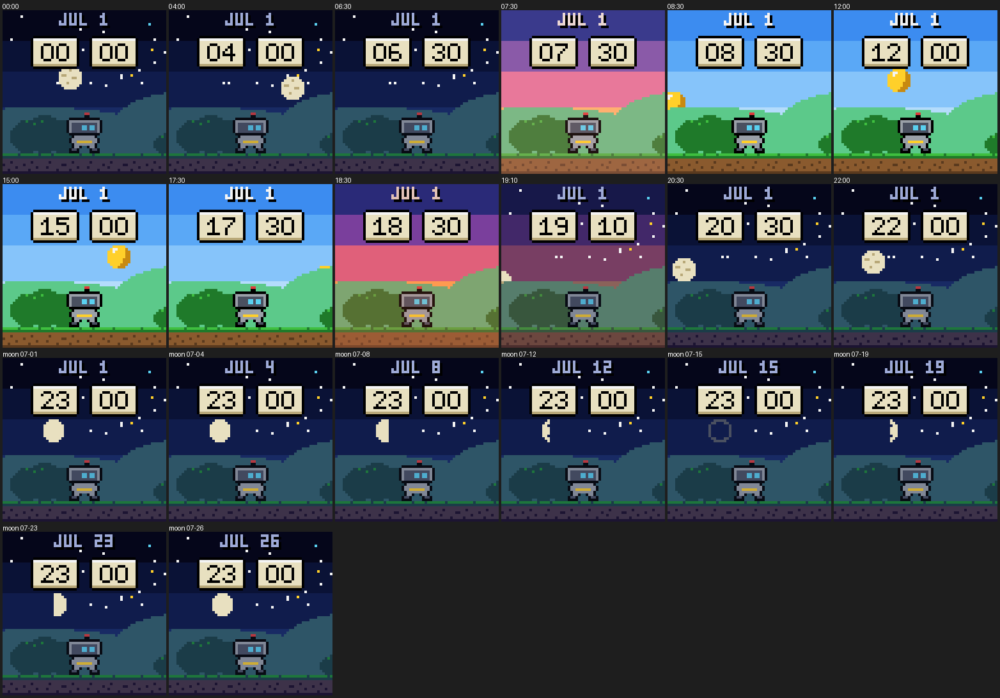
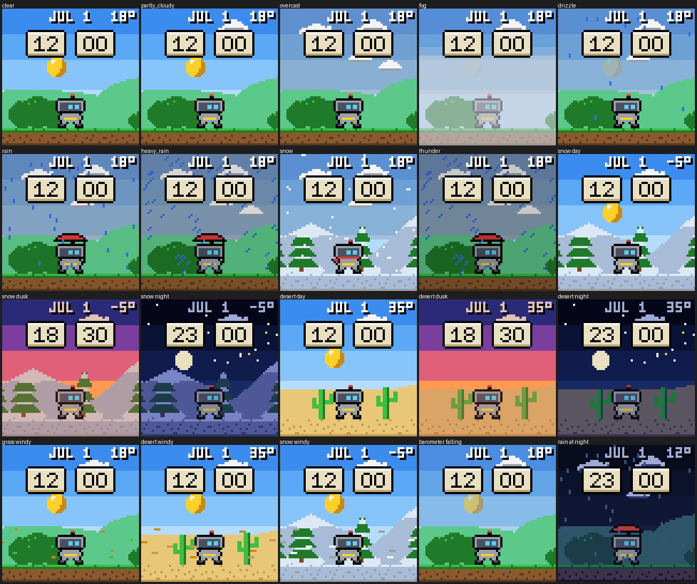
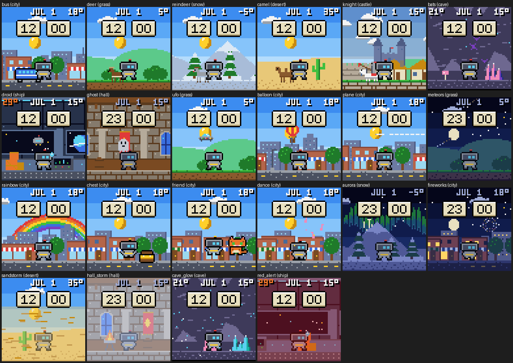

# Pixelwalk

Side-scrolling platformer clock for a 64x64 RGB LED panel on a Raspberry Pi. A pixel-art hero walks
through a world that follows the time of day, the weather and (optionally) the room, and two or three
times a day something bigger happens (a tram passes, a UFO drifts by, the hero finds a chest). It runs on
your PC first, in a browser, so you can try everything without a panel.
Design notes: [docs/spec.md](docs/spec.md) (historical; this README is the current reference).

*Rendered by `pixelwalk.tools.contact_sheet` (`--weather` for the second sheet, `--moments` for the third).*

## What you need

**Required**

- A **64x64 HUB75 RGB LED panel** (other sizes are not supported: the art and layout are drawn for 64x64)
  and a Raspberry Pi wired to it for [hzeller/rpi-rgb-led-matrix](https://github.com/hzeller/rpi-rgb-led-matrix),
  with its **Python bindings** (`rgbmatrix`) built against the same Pillow as this app. Pi 5 is not
  supported by that library. Developed and measured on a Pi 3B.
- Python 3.12+ and **Pillow 11.3.0**, pinned exactly in `pyproject.toml`. The `rgbmatrix` bindings are
  compiled against Pillow's internal headers, so they must be built for the same Pillow version this app
  runs on. A different version may work, but only 11.3.0 is tested (the golden-image tests assume it);
  if you change it, rebuild the bindings and edit the pin.

**Optional** (each one switched off with `backend = "none"`; the app then does without)

- a **light sensor** (brightness follows the room, and a dim room is a cave; without it brightness is fixed),
- an **indoor temperature / pressure sensor** (top-left temperature, barometer-driven clouds, and a hot
  room is a spaceship),
- a **PIR motion sensor** (the hero sleeps and the panel goes dark when nobody is around),
- **weather** from Open-Meteo (needs your coordinates and a network).

## Panel and library settings

`config/default.toml` `[display]` maps onto the library's options: `hardware_mapping` (`regular`,
`adafruit-hat`, `adafruit-hat-pwm`, ...), `gpio_slowdown` (raise it on a faster Pi, or if the picture
flickers), `rotation`, `max_brightness_pct`. Anything else the library supports goes under
`[display.matrix]` by its option name and is checked against the installed bindings:

    [display]
    hardware_mapping = "adafruit-hat"
    [display.matrix]
    pwm_bits = 9
    led_rgb_sequence = "RBG"      # panels whose colours come out swapped
    limit_refresh_rate_hz = 120

Notes: the library needs root to reach the GPIO and then drops privileges, so `state/` and any cache
must be writable by the `daemon` user (see `deploy/README.md`). A 64x64 panel needs the E address
line connected (on the Adafruit bonnet, solder the jumper). A single panel only: `chain_length`
and `parallel` are fixed at 1. Disabling the Pi's on-board audio and `isolcpus=3` help the refresh rate.
`display.backend = "emulator"` (a browser view via RGBMatrixEmulator) and `"png"` need no hardware.

## Dev setup

Open in the devcontainer (Python 3.12), or locally:

    python -m venv .venv && .venv/Scripts/pip install -e ".[dev]"   # Scripts -> bin on Linux
    pytest
    .venv/Scripts/python -m pixelwalk --profile dev   # then open http://localhost:8888
    .venv/Scripts/python -m pixelwalk --profile dev --at "2026-12-24 21:30" --speed 60

Edit `scenarios/default.toml` while it runs to change simulated inputs.

Use the venv's Python (`.venv\Scripts\python` on Windows, `.venv/bin/python` on Linux) for every
`python -m pixelwalk...` command; the system Python does not have the package installed.
`scripts\check.cmd` does this for you.

Tools:

    .venv\Scripts\python -m pixelwalk.tools.contact_sheet --out out\contact.png
    .venv\Scripts\python -m pixelwalk.tools.frame_dump --speed 1440 --seconds 60 --out out\day.gif
    .venv\Scripts\python -m pixelwalk.tools.build_assets

## Fully off in the dark

The brightness controller can turn the panel completely off when the room is dark. It is
**disabled by default** (`off_below_lux = 0`) because the right thresholds depend on the real
light sensor. To enable it, put this in `config/local.toml` (or `/etc/pixelwalk/config.toml` on
the Pi) and tune the numbers from real readings:

    [brightness]
    off_below_lux = 5.0     # light must stay below this for off_delay_s before the panel goes dark
    on_above_lux = 12.0     # and above this for on_delay_s before it comes back (must be higher)
    off_delay_s = 10
    wake_on_motion = false  # true: movement lights the display while it is dark

The sensor also sees the panel's own light, so read it with the panel on and off before choosing
the two thresholds. A missing or unreadable sensor never turns the panel off. To try it on the PC,
edit `lux` in `scenarios/default.toml` while the demo runs.

## Weather

On the PC the weather comes from the scenario file (`scenarios/default.toml`): set `weather`
(any Condition name: CLEAR, PARTLY_CLOUDY, OVERCAST, FOG, DRIZZLE, RAIN, HEAVY_RAIN, SNOW,
THUNDER), `outdoor_c`, `gust_kmh`, `lux` and `pressure_hpa` while the demo runs. The biome
follows the outdoor temperature (snowfield at or below 0 C or while snowing, desert at or above
28 C, the city between 10 and 24 C, grassland in between, with 2 C of hysteresis); a dim room
(indoor light under 20 lux, if you have the light sensor) wins over all of that and sends the
robot into a cave, with no sky or weather, and a hot room (indoor over 27 C) puts it aboard a
spaceship. Overcast, fog or gusts of 30 km/h or more bring a medieval castle, and once the sun
is down the robot goes inside, to the castle hall. The city lights up its windows and street
lamps from dusk. A change walks the robot through a pipe. The dev profile keeps a
biome for at least 15 s (10 minutes on the Pi) so you can see it react.

The rules apply in this order, so the room wins over the weather:

| Biome | Chosen when | Looks like |
|---|---|---|
| CAVE | indoor light under 20 lux (leaves above 40) | rock wall, stalactites, glowing crystals, mushrooms |
| SHIP | indoor temperature above 27 C (leaves below 25) | hull plating, viewports on to space, consoles, cryo pods |
| SNOW | outdoor 0 C or below, or snowing | snowfield, pines, peaks |
| DESERT | outdoor 28 C or above | dunes, cacti |
| CASTLE | OVERCAST or FOG, or gusts of 30 km/h or more (leaves below 22), by day | castles on hills, a village with a wall, banners, oaks |
| HALL | the same weather, once the sun is down | stone hall, arched windows, tapestries, braziers |
| CITY | outdoor 10 to 24 C | shopfronts, street lamps, a skyline; windows light up from dusk |
| GRASS | everything else (0 to 10 C, 24 to 28 C) | green hills and bushes |

The cave, the hall and the spaceship are indoors: they have a wall instead of a sky and show no sun,
moon, clouds or weather. Without a light sensor there is no cave, and without an indoor temperature
there is no spaceship. Unknown weather keeps the current biome.

To use the real forecast (Open-Meteo, no API key for non-commercial use), put your coordinates in
`config/local.toml`, which is not committed. They are rounded to two decimals in the request and
never written to the cache file:

    [weather]
    backend = "openmeteo"
    latitude = 48.85
    longitude = 2.35

It polls every 15 minutes in a background thread, keeps the last result when the network is down,
caches it in `state/weather.json` so a restart without network still has weather, and treats a
result older than 3 hours as unknown. A falling barometer (1.6 hPa or more over 3 hours) clouds
the sky over even without a forecast.

To review every condition and biome at once:

    .venv/Scripts/python -m pixelwalk.tools.contact_sheet --weather --out out/weather.png

## Demo mode

A scripted tour of the features, about 13 minutes, looping until you stop it (Ctrl-C):

    .venv/Scripts/python -m pixelwalk --profile dev --demo        # then open http://localhost:8888

It covers the clock bump and the hour change, dawn, dusk and night with the moon, two time-lapses,
every weather condition, the snow, grass, desert, city and castle biomes through the pipe, the cave in a dim room, the castle hall and a spaceship, the barometer, and the
brightness range ending in fully off and back on, the sleep-and-wake sequence, the robot's
moods and every event and date special, and a few of the moments. Each step's label is printed to the log.
On the Pi (profile `pi-check`, see `deploy/README.md`) it runs on the real panel.

The script is `scenarios/demo.toml`: a `[[sim.timeline]]` list of steps, each firing at `at`
seconds after the start. A step can set the simulated clock (`time`, `speed`) and override any
scenario value (`weather`, `outdoor_c`, `gust_kmh`, `lux`, `pressure_trend`, `event`, ...). Every step
starts from the `[sim]` values, so nothing leaks between steps. Demo mode switches to a simulated
clock, shortens the biome minimum stay to 8 s and turns on dark mode (your own settings win).

## Presence, status row and the robot's rest

When nobody moves for `presence.idle_after_s` (5 minutes) the robot sits by a campfire, falls
asleep (a "z" floats up) and the display dims to `presence.drowsy_factor`. After
`presence.dark_after_s` (15 minutes) the panel goes fully off. Movement wakes it: the robot
stretches and the brightness ramps back over a second. Optional quiet hours
(`presence.quiet_*`) switch the panel off sooner when the room is empty and cap the brightness
when it is not. With no motion sensor the room counts as always occupied. The top row shows the
indoor temperature (top-left; cyan below `hero.cold_c`, orange above `hero.hot_c`) and the outdoor
temperature (top-right), with the date (`NOV 16`) between them; each can be switched off under `[hud]`.

Real sensors are read from the kernel drivers' sysfs files (`sensors.backend = "sysfs"` with the
paths of your drivers' files, see `config/examples/pi-sensors.toml`; any unreadable file just means
"no reading") and the PIR from a GPIO line with libgpiod
(`motion.backend = "gpio"`, both the 1.x and 2.x Python APIs work). The demo (`--demo`) shows
the whole sleep-and-wake sequence with shortened timings.

## Swapping the character and the scenery

Both are choices, not code. In `config/local.toml`:

    [hero]
    character = "robot"     # robot or cat, or any complete character in assets/src (char_<name>.txt)

    [world]
    biome = "auto"          # "auto" follows the weather; or pin grass, snow, desert, city, cave, castle, hall or ship

With `control.enabled = true` the same two choices are in the control page's "Look" group and apply
live (a pinned biome plays the pipe trip). A character is five sprites named `<name>_walk`, `_idle`,
`_jump`, `_sit` and `_wake`; `python -m pixelwalk.tools.build_assets` says what a new one is missing.
A second complete character is also the friend who stops by in one of the moments (see below).
The `new-character-or-theme` skill (`.claude/skills`) walks through drawing a character, a biome or a
moment.

## Moods, events and date specials

The robot reacts to the weather and the room: an umbrella in rain, a scarf in snow or when the
room is colder than `hero.cold_c`, and a sweat drop when it is hotter than `hero.hot_c` (weather
wins over the room). Now and then something extra happens, never during a pipe trip, a clock bump
or while the robot rests, and never two at once:

- a **bird** crosses the sky by day, a **shooting star** streaks across at night,
- a **coin** appears ahead and the robot picks it up (sparkles),
- a burst of **sparkles** over both blocks when the hour changes.

Dated looks come from `[events]` in the config: `lights` (a string of bulbs over the clock),
`pumpkins` (they roll past, faces glowing) and `cake` (confetti). Each `[[events.dated]]` entry
has a name, a `from` and `to` date as `"MM-DD"` (inclusive, a range may wrap the new year) and a
style; the defaults are Christmas lights on 1-26 December and pumpkins on 25-31 October. A cake
rolls past on every date in `events.birthdays`: put real dates only in `config/local.toml`, which
is not committed. `events.enabled` switches all of it off, `events.rate` scales how often random
events happen (0 keeps only the dated looks); both can be changed while running. In demo mode or
a scenario, `event = "bird"` (or `coin`, `shooting_star`, `lights`, `pumpkins`, `cake`) shows one now.

## Moments: a few bigger things a day

On top of the walking robot, two or three times a day something bigger happens, at random times
between 08:00 and 22:00 while the display is on (the day's plan comes from the date, so a restart
does not change it, and at least 30 minutes pass between two). Each one waits for a scene it fits:

- **Cameos**, something that lives in the biome passes by: a tram in the city, a deer on the
  grass, a reindeer in the snow, a camel in the desert, a knight on horseback at the castle, bats in
  the cave, a droid on the spaceship, a ghost in the hall.
- **Sky visitors** (outdoors, in fair weather): a UFO, a hot-air balloon, a plane with a contrail,
  a meteor shower at night, a rainbow in drizzle.
- **Stories**, where the robot is part of it: it finds a treasure chest and opens it, meets the other
  character (they hop together and the friend walks on), or stops to dance.
- **Scenery changes**: an aurora over the snow, fireworks over the city, a sandstorm in the desert,
  lightning through the hall's windows, glow-worms in the cave, a red alert on the spaceship.

A pipe trip or a nap interrupts a moment (its time is kept for later), and no random event starts
while one plays. `[moments]` in the config has `enabled` and `per_day` (2.5 is two or three; 0 turns
them off); both can be changed while running (control page, "Extras"). In demo mode or a scenario,
`event = "chest"` (any moment name) shows one now. To review all of them:

    .venv/Scripts/python -m pixelwalk.tools.contact_sheet --moments --out out/moments.png

## Using other hardware

The scene and the behaviour (`logic/`, `render/`) never touch hardware: they see only the small
interfaces in `src/pixelwalk/ports.py`. Every input and output is chosen by a `backend` setting:

| Setting | Built in | Needs |
|---|---|---|
| `sensors.backend` | `sim`, `sysfs`, `none` | `read() -> SensorReading` (any field may be `None`) |
| `motion.backend` | `sim`, `gpio`, `none` | `motion() -> bool \| None`, `close()` |
| `weather.backend` | `sim`, `openmeteo`, `none` | `get() -> Weather \| None` |
| `display.backend` | `emulator`, `png`, `matrix` | `show(frame)`, `set_brightness(pct)`, `close()` |

`none` means the app simply does without: no light sensor gives the fallback brightness and no
temperature, no motion input means the room is always occupied, no weather keeps a clear sky.
Every other value is cheap to leave out, so a board with only a light sensor, or none, works.

To use your own device (an I2C sensor, an MQTT feed, a different LED panel), write a factory and
name it in the config as `"package.module:factory"`:

    # my_hw.py, anywhere on PYTHONPATH
    from pixelwalk.ports import SensorReading

    class MyLux:
        def __init__(self, section, ctx):
            self.clock = ctx.clock
            self.address = section["address"]          # your own keys sit next to `backend`
        def read(self):
            return SensorReading(lux=my_driver(self.address), temperature_c=None,
                                 humidity_pct=None, pressure_hpa=None, at=self.clock.now())

    def factory(section, ctx):
        return MyLux(section, ctx)

    # config/local.toml
    [sensors]
    backend = "my_hw:factory"
    address = 0x10

`read()`, `motion()` and `get()` must never raise (return `None` for a missing value) and must not
block for long. If the object also has `start()` and `stop()` they run around the main loop, the
way to poll a slow source from a thread (see the weather adapter). `ctx` gives the clock, the
project root and the whole config. A test checks that `logic/` and `render/` import no adapter.

## Maximum brightness

`display.max_brightness_pct` is the panel's ceiling. The application works in 0-100 *relative* to
it: with a ceiling of 60, the app's "100%" is 60% on the panel, its 50% is 30%, and 0 is still off.
The brightness curve (`brightness.*`) and presence dimming are all relative values.

## Changing settings while it runs

Every tunable (ceiling, brightness curve, dark mode, presence timings, quiet hours, status row,
cold/hot thresholds, events, 12/24 h, biome minimum stay) can be changed on the running app. Changes
are validated together (a request with one bad value changes nothing), applied within a frame,
and remembered in `state/settings.json` so they survive a restart; "Reset" returns to the config
file. Turn on the control page in `config/local.toml`:

    [control]
    enabled = true
    port = 8080
    # host = "127.0.0.1"   # only this machine (the default)
    # host = "0.0.0.0"     # reachable from your network: set a token too
    # token = "something-long"

Then open http://localhost:8080 (add `?token=...` if you set one). The page shows what the display
is doing right now, lets you change every setting, and, when the simulated backends are in use,
lets you change the weather, temperatures, light, motion and the clock to try things out. There is
also a JSON API (`GET/POST /api/params`, `POST /api/reset`, `GET /api/state`,
`GET/POST /api/scenario`), for example:

    curl -X POST localhost:8080/api/params -H "Content-Type: application/json" \
         -d '{"display.max_brightness_pct": 60}'

**Security:** there is no login. Anyone who can reach the port can change the display, so it is
off by default, listens on 127.0.0.1 unless you change it, and logs a warning if you expose it
without a token.

## License

MIT, see [LICENSE](LICENSE). The pixel art in `assets/` is covered by the same license. The panel is driven
by [hzeller/rpi-rgb-led-matrix](https://github.com/hzeller/rpi-rgb-led-matrix) (GPL-2.0), which is
installed separately and not included here.
